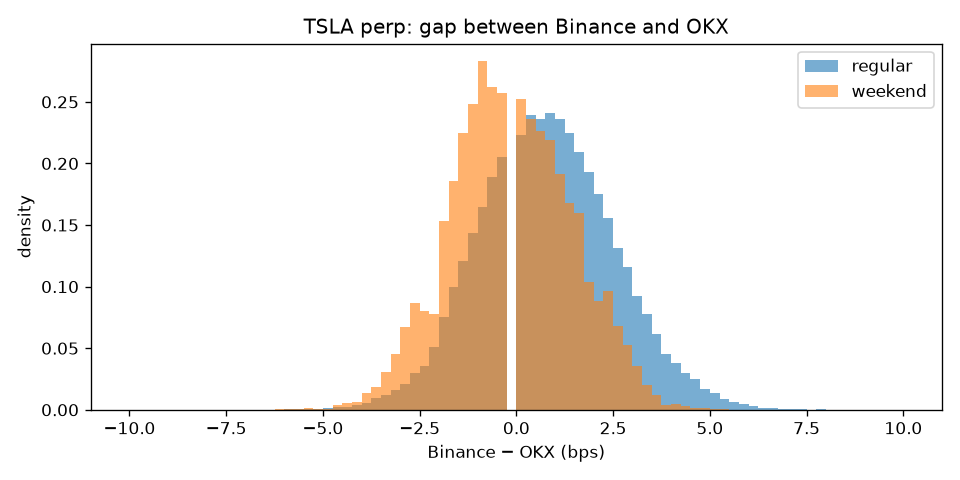
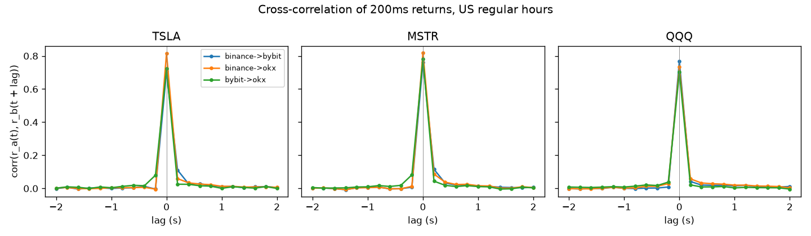
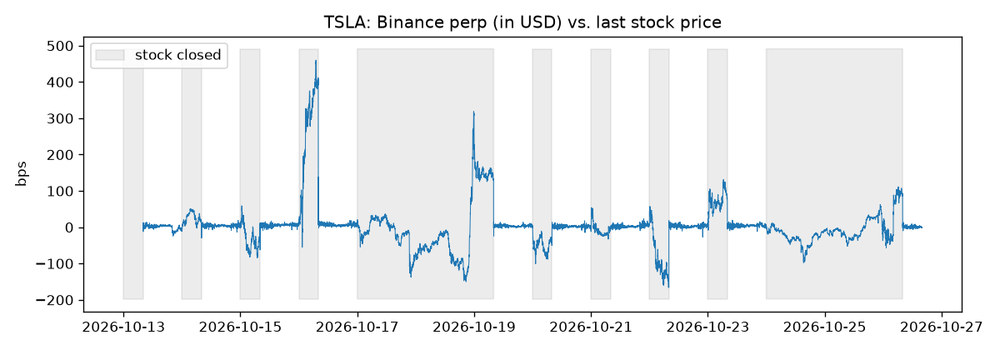
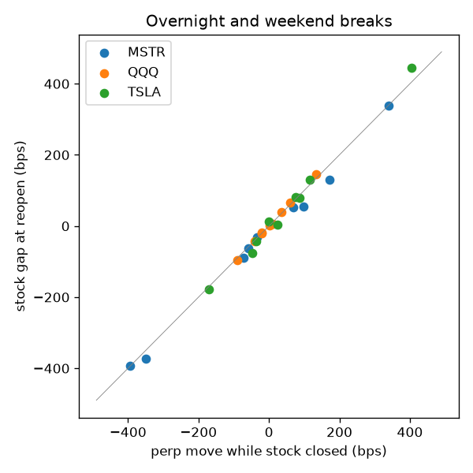
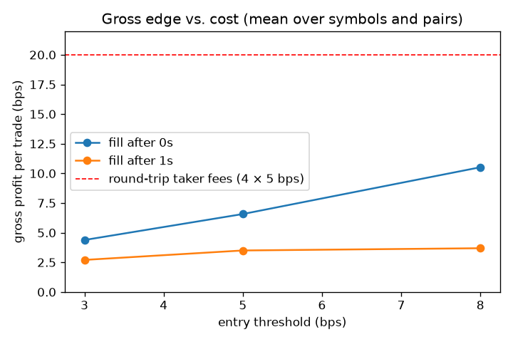

# crypto-cross-venue

Do the same equity perpetual contracts drift apart across crypto exchanges, and can that be traded?

This study uses two weeks of public trade data (2026-10-13 to 2026-10-26) for **TSLA, MSTR and QQQ perpetuals** on **Binance, Bybit and OKX**, plus 1-minute stock prices, to measure:

1. how large the price gaps between venues are, and how fast they close
2. which venue moves first
3. how the perps track the actual stock, inside and outside US trading hours
4. whether trading the gaps survives fees and latency

## Findings

**1. Gaps between venues are small and short-lived.** On a 1-second grid of last trade prices, the median absolute gap is 1–2 bps and the 99th percentile 4–8 bps, in every session. Gaps above 10 bps occur in under 0.2% of seconds. They decay with half-lives of about 2–12 seconds in US regular hours, and up to about 30 seconds at weekends.



**2. Binance leads.** Returns are most correlated at lag 0 (200 ms buckets), but the correlation just after zero is clearly asymmetric: Binance's moves show up on Bybit and OKX in the next 200–400 ms much more than the reverse. OKX in turn leads Bybit slightly. Binance has by far the most volume in these contracts (roughly 4–15× Bybit's).



**3. Perps track the stock closely in US hours, and carry price discovery when it is closed.**

- During regular hours, the Binance perp trades 15–18 bps above the stock in USDT terms. Almost all of that is the currency: USDT traded at about 0.9988 USD in this period. In USD the premium is 3–6 bps, with a standard deviation of 2–3 bps.
- When the stock is closed (20:00–04:00 New York time, and weekends), perps keep trading and move by up to ±400 bps. The perp's move over the break matches the stock's gap at the next open almost one-for-one (correlation 0.997–0.999, slope ≈ 1, 9 breaks per symbol).




**4. Trading the gap does not survive taker fees.** The strategy sells the rich venue and buys the cheap one when the gap deviates from its 30-minute rolling median by more than a threshold, and exits when it reverts. Gross profit per trade is 4–11 bps with instant fills and falls to 2–4 bps if fills arrive 1 second after the signal. Four taker fills at 5 bps cost 20 bps, so every configuration loses money. Breaking even with instant fills at the 8 bps threshold would need fees below about 2.6 bps per fill.



Taken together: these markets are already arbitraged on the timescale of a second. What is left is a contest of latency and fee tier (maker rebates, VIP levels), not of signal.

Full tables: [reports/tables.md](reports/tables.md).

## Caveats

- **Last trade prices, not quotes.** Free data has trades only. A gap between two last trades partly reflects one venue printing at the bid and the other at the ask, so gross profits above are optimistic: real fills would also pay the spread.
- **No order book depth or slippage.** Fills are assumed at the last trade price in any size.
- **Exchange timestamps.** Each venue stamps trades with its own matching-engine clock; lead-lag at sub-second scales is sensitive to clock offsets and publication delays.
- **Stock prices** are 1-minute bars from Yahoo Finance, including pre- and after-market (04:00–20:00 New York). The stock also trades overnight on venues Yahoo does not report, so "perp moves first" means relative to that feed, not to all stock trading.
- **Fees** are an assumption (5 bps taker per fill); actual fees vary by venue, contract and account tier.
- Two weeks and 9 overnight breaks per symbol are a small sample.

## Next steps

- Record top-of-book quotes (bid/ask) over WebSocket to measure gaps net of the spread
- Model maker-taker execution: post on the slow venue, hedge on the fast one
- Funding-rate differences between venues as a slower carry trade
- Longer history and more symbols (NVDA, AAPL, CRCL)

## Reproduce

```bash
python -m venv .venv
.venv/Scripts/pip install pandas numpy scipy matplotlib pyarrow yfinance tabulate   # Windows
python src/fetch.py --symbols TSLA MSTR QQQ --start 2026-10-13 --end 2026-10-26
python src/report.py
```

Data sources (all public): [Binance data](https://data.binance.vision), [Bybit public data](https://public.bybit.com), [OKX historical data](https://www.okx.com/data-download), Yahoo Finance (stocks), Kraken (USDT/USD). Downloaded data goes to `data/` and is not committed.
